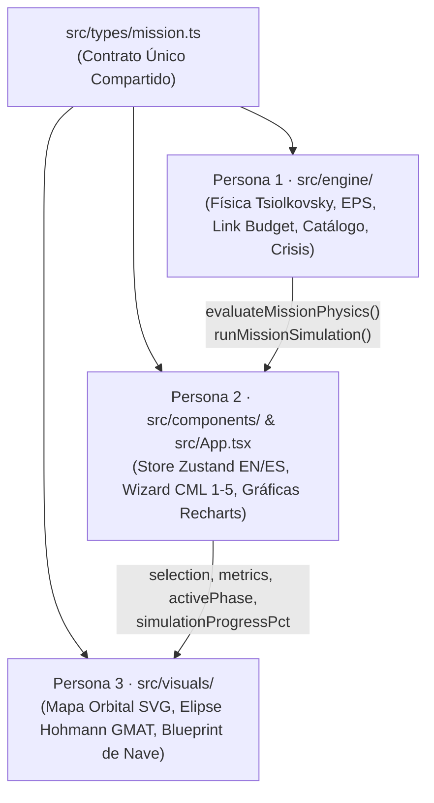

# Arquitectura del Sistema y Guía de Contrato Compartido (`ORBITAL FORGE`)

> Guía técnica centralizada para el equipo (**Persona 1 / Engine**, **Persona 2 / UI**, **Persona 3 / Visuals**). Sustituye la dependencia de notas locales para que cualquier integrante pueda consultar la arquitectura completa directamente en GitHub o VS Code.

---

## 1. Visión General del Sistema

**ORBITAL FORGE — Space Mission Design Lab** es un simulador y juego educativo interactivo de ingeniería concurrente espacial para diseñar, evaluar y operar una misión espacial desde el concepto inicial (**CML 1**) hasta la revisión de concepto (**CML 5 / MCR**) y la ejecución en vuelo (**Simulation**).

Su propósito pedagógico es hacer tangibles los compromisos reales de **SWaP-C** (*Size, Weight, Power, and Cost*) combinando:
- **Modo Cadete (`ExperienceMode = 'CADET'`):** Explicaciones accesibles con analogías cotidianas (`analogyTooltip`) para estudiantes.
- **Modo Ingeniero JPL (`ExperienceMode = 'JPL_ENGINEER'`):** Ecuaciones reales de Tsiolkovsky, balance solar $1/R^2$, Link Budget CCSDS en dB y márgenes CBE + MGA por TRL.

---

## 2. Diagrama de Flujo y Módulos Desacoplados (Equipo de 3)



### Propiedad Estricta por Rama y Carpeta

| Integrante | Rol Oficial (Para el Jurado) | Rama Git Principal | Carpeta Exclusiva | Qué entrega en código |
| :--- | :--- | :--- | :--- | :--- |
| **Hugo Andree Ccolque Huachaca** | Systems & Orbital Physics Engineer | `feat/engine` | `src/engine/`, `docs/` | `catalog.ts`, `physics.ts`, `simulation.ts`, `engine.test.ts` (12/12 tests), documentación técnica y merges a `main`. |
| **Jhonny Alberto Castillon Torres** | Educational UX & Mission Control Architect | `Jhonny---UI-/-Estado` | `src/components/`, `src/store/`, `src/App.tsx` | Store Zustand (`EN/ES`, `CADET/JPL_ENGINEER`), HUD Split-Screen, flujo CML 1–5, dilemas de crisis y audio synthesis. |
| **Marcos Josfat Vilcahuaman Esteban** | Aerospace Visualization & Storytelling Lead | `feat/visuals` | `src/visuals/` | `OrbitalMapVisualizer.tsx`, `SpacecraftBlueprint.tsx`, slides / video demo y validación NASA GMAT R2026a. |
| **Jeancarlos Antony Rondón Romero** ([@SiriusCode25](https://github.com/SiriusCode25)) | UI/UX Product Design & Prototyping Specialist | `feat/ui-design` | `design/`, `mockups/` | Prototipado interactivo UI/UX, arquitectura visual de cabina, wireframes aeroespaciales y especificaciones de componentes. |

> **Regla de oro de Git:** Nadie edita fuera de su carpeta ni modifica `src/types/mission.ts` unilateralmente. Todo cambio en el contrato se coordina y publica primero en `main`.

---

## 3. Flujo del Juego: CML 1 a CML 5 + Simulación

El simulador implementa la progresión de **Concept Maturity Levels (CML)** de NASA JPL y los **4 segmentos de misión** (*User, Space, Launch, Ground*) del NASA SmallSat Institute:

1. **Fase 1 (`CML_1` — Cocktail Napkin / User Segment):** Selección de disciplina (`EARTH_SCIENCE`, `HELIOPHYSICS`, `PLANETARY_SCIENCE`, `ASTROPHYSICS`), pregunta científica y objetivo en `SCIENCE_OBJECTIVES`.
2. **Fase 2 (`CML_2` — Initial Feasibility / Launch & Ground):** Selección de destino en `ORBITAL_DESTINATIONS` (`dest-leo`, `dest-geo`, `dest-moon`, `dest-mars`, `dest-jupiter`), estación terrena en `GROUND_STATIONS` y presupuesto base.
3. **Fase 3 (`CML_3` — Trade Space / Space & Launch):** Iteración sobre las **7 categorías** de `SUBSYSTEM_CATALOG` (`PAYLOAD`, `PROPULSION`, `EPS`, `TELECOM`, `THERMAL`, `ADCS`, `LAUNCH_VEHICLE`) observando sus compromisos SWaP-C y factores TRL.
4. **Fase 4 (`CML_4` — Point Design):** Cálculos en tiempo real con `evaluateMissionPhysics(selection)`: $\text{CBE} + \text{MGA} = \text{Predicted}$, masa húmeda/propelente (Tsiolkovsky), generación EPS vs. eclipse y Link Budget en dB.
5. **Fase 5 (`CML_5` — Baseline Concept / MCR Gate):** Puerta de revisión semafórica (`overallMCRStatus`: `GREEN` si márgenes $\ge 35\%$, `YELLOW` en `25%–34%`, `RED` si `< 25%` o exceso de lanzador/cofia/presupuesto), guiada por `flightDirectorAdvice` y `mcrChecklist`.
6. **Fase 6 (`SIMULATION` — Build, Verify & Operations):** Ejecución de `runMissionSimulation(selection, metrics, resolvedChoices)` recorriendo las 5 fases secuenciales (`LAUNCH_ASCENT`, `ORBIT_INSERTION`, `CRUISE_SPACE_WEATHER`, `SCIENCE_OPERATIONS`, `DATA_DOWNLINK`), resolviendo los 3 dilemas de crisis (`dilemmas`) y mostrando el puntaje `0–100`, calificación `S | A | B | C | FAIL` y comparativa contra `realWorldBenchmark`.

---

## 4. Guía de Consumo del Motor (`src/engine/index.ts`)

Tanto Persona 2 como Persona 3 deben importar exclusivamente desde `../engine` (o `./engine`) y `../types/mission` — **nunca duplicar ecuaciones en componentes ni llamar librerías de red**.

```ts
import {
  DEFAULT_MISSION_SELECTION,
  ORBITAL_DESTINATIONS,
  PRESET_MISSION_SELECTIONS,
  SCIENCE_OBJECTIVES,
  SUBSYSTEM_CATALOG,
  GROUND_STATIONS,
  evaluateMissionPhysics,
  findDestinationById,
  findGroundStationById,
  findObjectiveById,
  findSubsystemById,
  getSubsystemsByCategory,
  runMissionSimulation,
  runEngineTestSuite,
} from '../engine';
import type {
  CMLPhase,
  ExperienceMode,
  Language,
  MissionSelection,
  PhysicsMetrics,
  SimulationResult,
} from '../types/mission';

// 1. Evaluar física en vivo cada vez que cambie `selection` (función pura y síncrona, SIN useEffect)
const metrics: PhysicsMetrics = evaluateMissionPhysics(selection);

// 2. Obtener la lista inicial de dilemas de crisis para la UI antes/durante el vuelo
const initialSim: SimulationResult = runMissionSimulation(selection, metrics);

// 3. Recalcular el resultado final cuando el usuario resuelve los 3 dilemas en vuelo
const finalSim: SimulationResult = runMissionSimulation(
  selection,
  metrics,
  resolvedChoices, // e.g. { 'crisis-solar-cme': 'opt-safe-mode', ... }
);
```

### Atajos útiles del catálogo
- Cargar una misión ganadora automática (botón *"Cargar Preset NASA"* en la UI):
  `PRESET_MISSION_SELECTIONS['obj-earth-bionutrients']`, `PRESET_MISSION_SELECTIONS['obj-helio-lunar-trailblazer']`, `PRESET_MISSION_SELECTIONS['obj-mars-reconnaissance']`, `PRESET_MISSION_SELECTIONS['obj-jupiter-clipper']`.
- Obtener subsistemas por pestaña del wizard: `getSubsystemsByCategory('PROPULSION')`.
- Textos bilingües sin condicionales repetidos: `label[language]`, `metrics.flightDirectorAdvice.headline[language]`.

---

## 5. Guía Específica para Visualización (`src/visuals/` — Persona 3)

### A. Mapa Orbital (`OrbitalMapVisualizer.tsx`)
Maneja los **5 IDs de destino** disponibles en `ORBITAL_DESTINATIONS`:
- `'dest-leo'`: Órbita baja circular (`500 km`, eclipse `37%`, enlace corto comercial).
- **`'dest-geo'` (Validado en NASA GMAT R2026a):** Órbita Geoestacionaria (`35,786 km`, $\Delta V = 3,673\text{ m/s}$).
  - **Recomendación visual:** Cuando `selection.destinationId === 'dest-geo'`, renderiza la **elipse de transferencia de Hohmann** conectando la órbita de estacionamiento LEO con el anillo circular GEO (`35,786 km`), resaltando los dos nodos de encendido:
    1. **Burn 1 (`TOI` — Transfer Orbit Injection):** `+2,240 m/s` en perigeo LEO.
    2. **Burn 2 (`GOI` — Geostationary Orbit Insertion):** `+1,433 m/s` en apogeo GEO.
    3. Nota visual opcional: *"Hohmann Transfer verified in NASA GMAT R2026a (`Ex_HohmannTransfer`, DC 12 iterations)"*.
- `'dest-moon'`: Trayectoria translunar + órbita polar lunar (`384,400 km`, eclipse `25%`).
- `'dest-mars'`: Transferencia heliocéntrica a `1.52 AU` (irradiancia solar cae a `589 W/m²`, enlace DSN `34m`).
- `'dest-jupiter'`: Trayectoria exterior a `5.20 AU` (`50.3 W/m²`, retardo ~43 min, radiación extrema y enlace DSN `70m`).

### B. Fases y Alertas Visuales Durante `SIMULATION`
Las 5 fases reales emitidas por `runMissionSimulation()` en `SimulationEvent.phase` (`SimulationPhaseName`) son:
1. `'LAUNCH_ASCENT'` (día 0 — alerta crítica si `!metrics.volume.isCompliant` o `metrics.wetMass_kg > metrics.launchCapacity_kg`).
2. `'ORBIT_INSERTION'` (día 1 en LEO o día 45 fuera de LEO — alerta si `deltaV_available_ms < deltaV_required_ms`).
3. `'CRUISE_SPACE_WEATHER'` (día 18 o 94 — coincide con dilema `'crisis-solar-cme'`).
4. `'SCIENCE_OPERATIONS'` (día 46 o 215 — coincide con dilema `'crisis-eclipse-thermal'`).
5. `'DATA_DOWNLINK'` (día 88 o 340 — coincide con dilema `'crisis-downlink-rain'`).

---

## 6. Estándares de Código Limpio y Anti-Patrones Prohibidos

Estándares compartidos del equipo para evitar bugs de integración y mantener compilación estricta (`noUnusedLocals`, `noUnusedParameters`, `verbatimModuleSyntax`, `erasableSyntaxOnly`):

- ❌ **Prohibido usar `any` en TypeScript:** Usa interfaces de `src/types/mission.ts` o *type narrowing*.
- ❌ **Prohibido usar `useEffect` para cálculos derivados:** `evaluateMissionPhysics(selection)` es una función pura que tarda $< 1\text{ ms}$. Calcúlala directamente con `useMemo` o dentro del selector/estado derivado de Zustand.
- ❌ **Prohibidos componentes gigantes (> 250 líneas):** Divide el wizard CML 1–5 en subcomponentes claros (`PhaseStep1User`, `TradeSpacePanel`, `MCRReviewGate`, `FlightCrisisModal`, `BenchmarkSummary`).
- ❌ **Prohibidos `catch` vacíos:** Si un bloque captura error (ej. lectura de `localStorage`), maneja el fallback con `DEFAULT_MISSION_SELECTION`.
- ❌ **Prohibido usar logos oficiales de la NASA en JSX/SVG:** Ver [GUIA_HACKATHON_Y_ENTREGABLES.md](./GUIA_HACKATHON_Y_ENTREGABLES.md).
