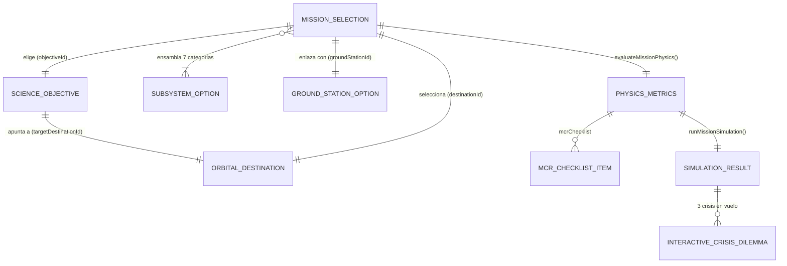

# Esquema de Datos, Catálogo Completo e IDs Exactos

Referencia definitiva de todas las entidades de `src/types/mission.ts` y los IDs implementados en `src/engine/catalog.ts` y `src/engine/simulation.ts` para evitar errores de *typo* al conectar UI y visuales.

---

## 1. Modelo de Persistencia y Flujo de Datos (Cliente 100%)

- **Persistencia:** 100% Client-Side mediante **Zustand (`persist` en `localStorage`)** + catálogo determinista en memoria (`src/engine/catalog.ts`). Sin backend externo para garantizar latencia cero y confiabilidad total en la demo del jurado.
- **Idioma y Modo:** El estado global almacena `language: 'en' | 'es'` (`'en'` por defecto por requisito global de Space Apps) y `experienceMode: 'CADET' | 'JPL_ENGINEER'`.

---

## 2. Destinos Orbitales (`ORBITAL_DESTINATIONS` — 5 destinos)

| ID | Nombre (`en` / `es`) | Dist. Heliocéntrica | Dist. Tierra | $\Delta V$ Requerido | Irradiancia $S$ | Eclipse | Retardo 1-vía | Red Requerida (`Link >= dB`) |
| :--- | :--- | :---: | :---: | :---: | :---: | :---: | :---: | :--- |
| `'dest-leo'` | Low Earth Orbit (LEO · 500 km) / Órbita Baja Terrestre | `1.0 AU` | `1,200 km` | `150 m/s` | `1,361 W/m²` | `0.37` | `0.005 s` | `COMMERCIAL_GN` (`6 dB`) |
| `'dest-geo'` | **Geostationary Orbit (GEO · 35,786 km)** *(GMAT R2026a)* | `1.0 AU` | `35,786 km` | **`3,673 m/s`** | `1,361 W/m²` | `0.05` | `0.12 s` | `NEAR_EARTH_NETWORK` (`6 dB`) |
| `'dest-moon'` | Lunar Polar Orbit (100 km) / Órbita Polar Lunar | `1.0 AU` | `384,400 km` | `3,950 m/s` | `1,361 W/m²` | `0.25` | `1.28 s` | `NEAR_EARTH_NETWORK` (`6 dB`) |
| `'dest-mars'` | Mars Science Orbit (1.52 AU) / Órbita de Marte | `1.52 AU` | `225,000,000 km` | `4,500 m/s` | `589 W/m²` | `0.15` | `750 s` | `DSN_34M` (`3 dB`) |
| `'dest-jupiter'` | Jupiter / Jovian System (5.20 AU) / Júpiter | `5.20 AU` | `778,000,000 km` | `6,800 m/s` | `50.3 W/m²` | `0.12` | `2,595 s` | `DSN_70M` (`3 dB`) |

---

## 3. Objetivos Científicos (`SCIENCE_OBJECTIVES` — 4 misiones)

| ID | Disciplina | Destino Base | Payload(s) Requerido(s) | Min Rate | Presupuesto | Duración | Benchmark Real NASA/CSA |
| :--- | :--- | :--- | :--- | :---: | :---: | :---: | :--- |
| `'obj-earth-bionutrients'` | `EARTH_SCIENCE` | `'dest-leo'` | `['pay-multispectral']` | `64 kbps` | `$25M` | `2 años` | NASA BioNutrients-2 & PACE (LEO) (`26 kg`, `45 W`, `$18M`) |
| `'obj-helio-lunar-trailblazer'` | `HELIOPHYSICS` | `'dest-moon'` | `['pay-ir-spectrometer']` | `256 kbps` | `$95M` | `2 años` | NASA Lunar Trailblazer & PUNCH (`210 kg`, `280 W`, `$72M`) |
| `'obj-mars-reconnaissance'` | `PLANETARY_SCIENCE` | `'dest-mars'` | `['pay-sar-radar']` | `128 kbps` | `$280M` | `3 años` | NASA Mars Reconnaissance Orbiter (MRO) (`2,180 kg`, `1,500 W`, `$720M`) |
| `'obj-jupiter-clipper'` | `ASTROPHYSICS` | `'dest-jupiter'` | `['pay-ir-spectrometer', 'pay-multispectral']` | `32 kbps` | `$320M` | `5 años` | NASA Europa Clipper & JWST / CSA FGS (`3,240 kg`, `700 W`, `$1,200M`) |

---

## 4. Catálogo Completo de Subsistemas (`SUBSYSTEM_CATALOG` — 22 ítems en 7 categorías)

### 1. Carga Útil (`PAYLOAD`)
| ID | Nombre (`en`) | Masa CBE | Potencia (Nom / Pico) | Costo | Volumen | TRL (MGA) |
| :--- | :--- | :---: | :---: | :---: | :---: | :---: |
| `'pay-multispectral'` | Optical Multispectral Imager | `3.5 kg` | `6 W / 12 W` | `$4.2M` | `3U` | `TRL 9 (8%)` |
| `'pay-ir-spectrometer'` | Cryogenic IR Spectrometer | `18 kg` | `20 W / 45 W` | `$22M` | `16U` | `TRL 6 (18%)` |
| `'pay-sar-radar'` | Active L-Band SAR Radar | `120 kg` | `95 W / 850 W` | `$95M` | `650U` | `TRL 5 (32%)` |

### 2. Propulsión (`PROPULSION`)
| ID | Nombre (`en`) | Tipo / $I_{sp}$ | Masa CBE | Potencia (Nom / Pico) | Costo | Volumen | TRL (MGA) |
| :--- | :--- | :--- | :---: | :---: | :---: | :---: | :---: |
| `'prop-cold-gas'` | N2 Cold-Gas Micro-Thrusters | `COLD_GAS` (`68 s`) | `2.8 kg` | `2 W / 5 W` | `$0.8M` | `1.5U` | `TRL 9 (8%)` |
| `'prop-biprop'` | MMH / NTO Bipropellant Engine | `BIPROP` (`315 s`) | `24 kg` | `6 W / 25 W` | `$12M` | `80U` | `TRL 8 (8%)` |
| `'prop-hall'` | Xenon Hall Electric Thruster (BHT-600) | `ELECTRIC_HALL` (`1750 s`) | `14.5 kg` | `120 W / 600 W` | `$16.5M` | `40U` | `TRL 6 (18%)` |

### 3. Potencia Eléctrica (`EPS`)
| ID | Nombre (`en`) | Generación @ 1 AU | Masa CBE | Consumo (Nom / Pico) | Costo | Volumen | TRL (MGA) |
| :--- | :--- | :---: | :---: | :---: | :---: | :---: | :---: |
| `'eps-body-mounted'` | Body-Mounted Solar Panels | `28 W` (`0.08 m²`) | `1.2 kg` | `0 W / 0 W` | `$0.4M` | `0.5U` | `TRL 9 (8%)` |
| `'eps-deployable'` | 2-Axis Deployable Solar Wings | `350 W` (`1.0 m²`) | `7.5 kg` | `2 W / 4 W` | `$3.5M` | `4U` | `TRL 7 (18%)` |
| `'eps-megaflex'` | Mega-Flex High-Power Solar Array | `4,200 W` (`12.0 m²`) | `28 kg` | `5 W / 10 W` | `$18M` | `16U` | `TRL 8 (8%)` |
| `'eps-rtg'` | Dual Next-Gen RTG (`isRTG: true`) | `240 W` constante | `52 kg` | `0 W / 0 W` | `$85M` | `250U` | `TRL 6 (18%)` |

### 4. Telecomunicaciones (`TELECOM`)
| ID | Nombre (`en`) | Freq / Tx / Ganancia | Tasa Máx. / Error Puntería | Masa CBE | Potencia (Nom / Pico) | Costo / Vol | TRL (MGA) |
| :--- | :--- | :--- | :---: | :---: | :---: | :---: | :---: |
| `'telecom-uhf'` | UHF / S-Band COTS Transponder | `0.437 GHz` / `2 W` / `3 dBi` | `128 kbps` / `<= 15°` | `0.9 kg` | `3 W / 12 W` | `$0.3M` / `0.5U` | `TRL 9 (8%)` |
| `'telecom-xka'` | X/Ka-Band High-Gain Dish (1.8 m) | `8.4 GHz` / `35 W` / `47 dBi` | `512 kbps` / `<= 0.5°` | `12 kg` | `15 W / 85 W` | `$9.5M` / `12U` | `TRL 8 (8%)` |
| `'telecom-laser'` | Deep-Space Optical Laser Terminal | `32.0 GHz` / `50 W` / `54 dBi` | `4096 kbps` / `<= 0.1°` | `14 kg` | `20 W / 110 W` | `$28M` / `35U` | `TRL 5 (32%)` |

### 5. Control Térmico (`THERMAL`)
| ID | Nombre (`en`) | Masa CBE | Potencia (Nom / Pico) | Costo | Volumen | TRL (MGA) |
| :--- | :--- | :---: | :---: | :---: | :---: | :---: |
| `'therm-passive'` | Passive MLI Blankets & Radiators | `2.1 kg` | `0 W / 0 W` | `$0.2M` | `1U` | `TRL 9 (8%)` |
| `'therm-active'` | Active Loop Heaters & Thermostats | `4.5 kg` | `10 W / 35 W` | `$1.1M` | `2U` | `TRL 8 (8%)` |
| `'therm-cryo'` | Pumped Fluid Loop & Cryocooler | `22 kg` | `55 W / 140 W` | `$15M` | `60U` | `TRL 6 (18%)` |

### 6. Control de Actitud (`ADCS`)
| ID | Nombre (`en`) | Precisión Apuntamiento | Masa CBE | Potencia (Nom / Pico) | Costo | Volumen | TRL (MGA) |
| :--- | :--- | :---: | :---: | :---: | :---: | :---: | :---: |
| `'adcs-gravity'` | Gravity-Gradient & Magnetorquers | `5.0°` | `1.5 kg` | `2 W / 3 W` | `$0.5M` | `1U` | `TRL 9 (8%)` |
| `'adcs-3axis'` | 3-Axis Reaction Wheels + Star Tracker | `0.02°` | `5.8 kg` | `14 W / 18 W` | `$3.8M` | `2.5U` | `TRL 8 (8%)` |
| `'adcs-rcs'` | Agile Cold-Gas RCS Attitude Control | `0.25°` | `8 kg` | `5 W / 8 W` | `$2.2M` | `3U` | `TRL 9 (8%)` |

### 7. Vehículos de Lanzamiento (`LAUNCH_VEHICLE`)
| ID | Nombre (`en`) | Cap. Masa Húmeda Máx. | Volumen Cofia (*Fairing*) | Costo | TRL (MGA) |
| :--- | :--- | :---: | :---: | :---: | :---: |
| `'lv-rideshare'` | LEO CubeSat Rideshare Dispenser | `45 kg` | `24U` | `$0.35M` | `TRL 9 (8%)` |
| `'lv-electron'` | Dedicated Small Launcher (Electron-class) | `300 kg` | `350U` | `$7.5M` | `TRL 9 (8%)` |
| `'lv-falcon9'` | Medium/Heavy Launcher (Falcon 9 / Atlas-class) | `4,500 kg` | `4,000U` | `$65M` | `TRL 9 (8%)` |

---

## 5. Estaciones Terrestres (`GROUND_STATIONS` — 4 redes)

| ID | Tipo (`GroundNetworkType`) | Nombre (`en`) | $G/T$ (`dB/K`) | Costo / Mes | Bandas Compatibles |
| :--- | :--- | :--- | :---: | :---: | :--- |
| `'gs-commercial'` | `COMMERCIAL_GN` | Commercial University Ground Dish (3 m) | `14` | `$0.04M` | `UHF`, `S-Band` |
| `'gs-near-earth'` | `NEAR_EARTH_NETWORK` | NASA Near-Earth Network (11 m) | `28` | `$0.15M` | `S-Band`, `X-Band`, `Ka-Band` |
| `'gs-dsn-34m'` | `DSN_34M` | Deep Space Network — 34m Beam Waveguide | `50` | `$0.45M` | `X-Band`, `Ka-Band`, `Optical` |
| `'gs-dsn-70m'` | `DSN_70M` | Deep Space Network — 70m Goldstone/Madrid/Canberra | `62` | `$0.9M` | `X-Band`, `Ka-Band`, `Optical` |

---

## 6. Los 4 Presets Oficiales (`PRESET_MISSION_SELECTIONS`)

Cada uno de los 4 presets aprueba el **MCR completo en Verde ($\ge 35\%$ de margen)** y puede cargarse con un clic desde la interfaz:

| Preset Key (`objectiveId`) | Destino | Payload(s) | Propulsión | EPS | Telecom | Thermal | ADCS | Lanzador | Antena Tierra |
| :--- | :--- | :--- | :--- | :--- | :--- | :--- | :--- | :--- | :--- |
| `'obj-earth-bionutrients'` | `'dest-leo'` | `['pay-multispectral']` | `'prop-cold-gas'` | `'eps-deployable'` | `'telecom-uhf'` | `'therm-passive'` | `'adcs-gravity'` | `'lv-rideshare'` | `'gs-commercial'` |
| `'obj-helio-lunar-trailblazer'` | `'dest-moon'` | `['pay-ir-spectrometer']` | `'prop-hall'` | `'eps-megaflex'` | `'telecom-xka'` | `'therm-active'` | `'adcs-3axis'` | `'lv-electron'` | `'gs-near-earth'` |
| `'obj-mars-reconnaissance'` | `'dest-mars'` | `['pay-sar-radar']` | `'prop-biprop'` | `'eps-megaflex'` | `'telecom-xka'` | `'therm-cryo'` | `'adcs-3axis'` | `'lv-falcon9'` | `'gs-dsn-34m'` |
| `'obj-jupiter-clipper'` | `'dest-jupiter'` | `['pay-ir-spectrometer', 'pay-multispectral']` | `'prop-biprop'` | `'eps-rtg'` | `'telecom-xka'` | `'therm-active'` | `'adcs-3axis'` | `'lv-falcon9'` | `'gs-dsn-70m'` |

---

## 7. Dilemas Interactivos de Crisis en Vuelo (`InteractiveCrisisDilemma`)

Generados dinámicamente por `runMissionSimulation()` en las Fases 3, 4 y 5:

| Dilemma ID | Fase (`SimulationPhaseName`) | Evento | Opción Óptima (`isOptimal: true`) | Opción Riesgosa (`isOptimal: false`) |
| :--- | :--- | :--- | :--- | :--- |
| `'crisis-solar-cme'` | `CRUISE_SPACE_WEATHER` | Tormenta solar Clase X (CME) | `'opt-safe-mode'` (`+12` score) | `'opt-push-science'` (`-18` score) |
| `'crisis-eclipse-thermal'` | `SCIENCE_OPERATIONS` | Enfriamiento en eclipse / pico térmico ADCS | `'opt-duty-cycle'` (`+14` score) | `'opt-overdrive'` (`-14` score) |
| `'crisis-downlink-rain'` | `DATA_DOWNLINK` | Atenuación atmosférica `-3.5 dB` en antena | `'opt-adaptive-rate'` (`+14` score) | `'opt-max-bitrate'` (`-16` score) |
